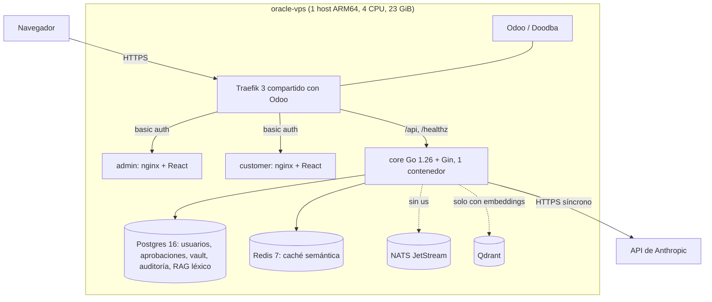
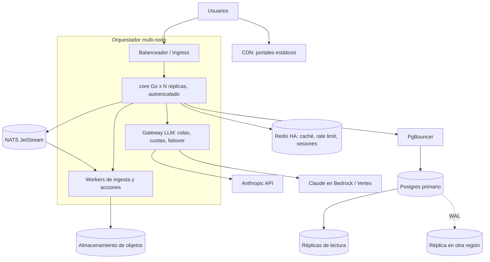

# Arquitectura Actual y Hoja de Ruta de Escalado

**Estado:** PROPUESTA (pendiente de decisión de Martin)  
**Fecha:** 2026-11-19  
**Issue:** [#46](https://github.com/onlyone-ai-pods/aipods-docs/issues/46)  
**Relacionado:** [SPEC-CORE-73](../specs/active/14_blue_green_zero_downtime_spec.md) (despliegue blue-green), issue [#36](https://github.com/onlyone-ai-pods/aipods-docs/issues/36) (FinOps por tenant)

---

## 1. Resumen

El diseño del core es el correcto para crecer: un monolito Go sin estado, con Postgres, Redis y JWT. Con SPEC-CORE-73 puede correr en varias instancias. No hace falta reescribirlo ni partirlo en microservicios.

Lo que hoy impide llegar a cientos de miles de usuarios es la infraestructura y el consumo del LLM:

- Todo corre en un solo VPS compartido con Odoo, sin backups automáticos de Postgres.
- El costo y el límite reales están en las llamadas a Claude, no en Go. A 200.000 usuarios el pico estimado es de unas 230 llamadas en curso y varios millones de tokens por minuto (sección 4).
- El chat es síncrono y no hay control de consumo por tenant.

La propuesta es crecer en cuatro etapas, cada una con un criterio de salida medible. La decisión pendiente es aprobar la **Etapa 1** (sección 5.2).

---

## 2. Arquitectura actual (verificada el 2026-11-19)

Verificado contra `aipods-core-engine` `main` @ `a9c2024` y el compose de producción de `deploy/` (no versionado).

| Componente | Estado real | Riesgo para escalar |
|---|---|---|
| Core (`cmd/server`) | 1 contenedor, Gin, sin apagado elegante ni readiness | Cada deploy corta peticiones (SPEC-CORE-73) |
| Postgres 16 | 1 contenedor con volumen local, pool pgx de 4 conexiones | Sin backups, sin réplica, sin pooler |
| Redis 7 | 1 contenedor sin persistencia configurada | Al reiniciar se pierde la caché (aceptable: es descartable) |
| Qdrant | Levantado pero sin uso: el RAG en producción es léxico (SPEC-CORE-70) | Consume recursos sin aportar |
| NATS JetStream | Levantado; el core recibe `NATS_URL` pero no lo usa | Ídem |
| LLM | Llamada síncrona a Claude por petición, sin cota de tiempo ni de concurrencia | Cuello de botella de costo y capacidad |
| Estado en RAM | Rate limiter, sagas, pods dinámicos, sandbox | No sobrevive a dos instancias (SPEC-CORE-73.R8-R11) |
| Observabilidad | `/metrics` por proceso, logs a stdout, sin trazas ni alertas | No se ve dónde se va el tiempo de una consulta |
| Despliegue | `docker compose up --build` en el VPS | Corte en cada deploy |

---

## 3. Diferencias entre la documentación y el sistema real

Estas afirmaciones de la documentación describen la arquitectura objetivo, no la actual. Conviene marcarlas así para que no se tomen como hechos en auditorías.

| Documento | Dice | Realidad | Propuesta |
|---|---|---|---|
| `docs/SDD_MANIFESTO.md` §3 | AWS CloudFront / WAF, Qdrant Cluster, Redis Active-Active | Traefik en un VPS, Qdrant y Redis de un nodo | Marcar el diagrama como objetivo y enlazar este documento (hecho en este PR) |
| `docs/SDD_MANIFESTO.md` §7.3 | RPO < 1 min, RTO < 15 min | Sin backups de Postgres | Marcarlo como objetivo de la Etapa 3 (hecho en este PR) |
| `docs/SDD_MANIFESTO.md` §5 | El dogfooding de CRM y billing corre por eventos en NATS | El paquete `internal/events` existe pero no está conectado; billing es un mock en memoria | Queda como objetivo |
| `specs/01_CORE_ENGINE_MASTER_SPEC.md` §1 y §2 | Go 1.22+, latencia sub-15 ms, swarm en ≈11,8 ms | Go 1.26; una consulta con Claude tarda segundos | Revisar al consolidar SPEC-CORE-73 (spec maestra: decide Martin) |
| `specs/01_CORE_ENGINE_MASTER_SPEC.md` §4 y `helm/aipods-core` | Helm chart con 3 réplicas y autoescalado | El chart no se usa; la imagen `v63.0.0` no se publica en GHCR | Retomar en la Etapa 2 o archivar |
| `specs/01_CORE_ENGINE_MASTER_SPEC.md` §5 | SLA de latencia p95 ≤ 15 ms | No aplica a respuestas del LLM | Separar SLO de API (ms) y de respuesta del LLM (s) |
| `docs/BACKLOG.md` | Escalable para +200 empresas | Sin medición de capacidad | Reemplazar por los criterios de salida de la sección 5 |
| `README.md` | Go 1.22+ | Go 1.26 (SPEC-CORE-62) | Corregido en este PR |

---

## 4. Estimación de carga

Supuestos, a revisar con datos reales de `/metrics` cuando haya tráfico:

- 10% de los usuarios registrados activos por día, y 10% de esos activos en simultáneo en el pico.
- Un usuario activo hace una consulta cada 2 minutos.
- Una consulta tarda 20 s en promedio y consume unos 6.000 tokens de entrada (sistema + RAG) y 800 de salida.
- La caché semántica (SPEC-CORE-71) evita un 30% de las llamadas.

| Usuarios registrados | Simultáneos en el pico | Consultas por segundo | Llamadas a Claude en curso | Tokens por minuto (con caché) |
|---|---|---|---|---|
| 1.000 | 10 | 0,08 | 1 | ~25.000 |
| 20.000 | 200 | 1,7 | 23 | ~480.000 |
| 200.000 | 2.000 | 17 | 230 | ~4.800.000 |

Lectura:

- **Go no es el límite.** 230 peticiones en curso son 230 goroutines esperando la red; una sola instancia lo maneja. Se agregan instancias por disponibilidad, no por CPU.
- **El límite es el proveedor del LLM.** Varios millones de tokens por minuto requieren un tier alto de Anthropic, o repartir entre Anthropic directo y Claude en AWS Bedrock o Google Vertex. Hay que confirmar los límites con Anthropic antes de la Etapa 3.
- **El costo crece lineal con el uso.** Cada punto de acierto de la caché y cada token de contexto RAG ahorrado bajan el costo directo. El control de consumo por tenant (#36) es necesario antes de abrir el registro.

---

## 5. Hoja de ruta por etapas

Cada etapa se cierra cuando se cumple su criterio de salida, no por fecha.

### 5.1 Etapa 0: base sin cortes (en curso)

- SPEC-CORE-72: pod AFIP informativo vs operativo, ingesta robusta.
- SPEC-CORE-73: apagado elegante, readiness, estado compartido, migraciones expand/contract, despliegue por colores.

**Criterio de salida:** un cambio de color con carga constante no produce errores 5xx (SPEC-CORE-73.R20).

### 5.2 Etapa 1: producción en un host propio (hasta unos 5.000 usuarios)

1. **Host dedicado para AI Pods**, separado del VPS de Odoo, con Traefik propio.
2. **Backups de Postgres:** `pg_dump` diario más archivado de WAL (pgBackRest o WAL-G) a almacenamiento de objetos fuera del host, con una restauración probada al mes.
3. **Respuestas en streaming (SSE)** en `/api/v1/chat/completions`: el usuario ve texto en menos de 2 s y el proxy no queda con conexiones mudas. Necesita una spec propia; SPEC-CORE-73 lo deja fuera de alcance.
4. **Gateway del LLM dentro del core:** una cola con concurrencia máxima global y por tenant, presupuesto de tokens por tenant y plan (retoma #36), timeout por llamada y registro de tokens usados.
5. **Observabilidad:** OpenTelemetry (trazas de petición → RAG → LLM), Prometheus y Grafana con alertas de error, latencia y gasto de tokens.
6. **Límites de recursos** en cada contenedor y `appendonly yes` en Redis si la caché se vuelve crítica para el costo.
7. **Apagar lo que no se usa:** Qdrant y NATS hasta que la etapa que los necesita los conecte.

**Criterio de salida:** restauración de backup probada; p95 del primer token menor a 3 s; ningún tenant puede pasar su presupuesto de tokens; alertas activas.

### 5.3 Etapa 2: varios nodos (hasta unos 50.000 usuarios)

1. **Orquestador con 2 o 3 nodos** (decisión D2): el core en 2 o más réplicas detrás del balanceador, con el despliegue por colores de SPEC-CORE-73 o el rolling update del orquestador.
2. **Postgres con alta disponibilidad:** gestionado (decisión D3) o primario + réplica con failover (Patroni o CloudNativePG), más **PgBouncer** en modo transacción. Lecturas de listados y auditoría a la réplica.
3. **Redis gestionado o con Sentinel.** No hace falta Redis Active-Active: la caché se puede reconstruir.
4. **Trabajo asíncrono en NATS JetStream:** ingesta de documentos (PDF extensos, ÉPICA 10) y acciones largas de los pods salen del ciclo HTTP. Workers en el mismo binario, con la regla de apagado de SPEC-CORE-73.R10.
5. **Portales en un CDN** y documentos originales en almacenamiento de objetos, no en disco del contenedor.

**Criterio de salida:** caída de un nodo sin pérdida de servicio; ingesta de un PDF de 200 páginas sin bloquear el chat; p95 de la API sin LLM menor a 100 ms.

### 5.4 Etapa 3: cientos de miles de usuarios

1. **Autoescalado** del core por peticiones en curso (no por CPU, que casi no se usa mientras se espera al LLM).
2. **Particionado** de `audit_log` por mes y de `rag_chunks` por hash de `tenant_id`. **Row-Level Security** en Postgres como segunda barrera del aislamiento multi-tenant, además del filtro en el código.
3. **Capacidad del LLM con más de un proveedor:** Anthropic directo más Claude en Bedrock o Vertex, con failover desde el gateway de la Etapa 1. Modelos más chicos para clasificar y expandir consultas, y el grande solo para redactar.
4. **Recuperación ante desastres en otra región:** réplica de Postgres en streaming y backups cruzados, con objetivo RPO < 1 min y RTO < 15 min (el que hoy declara el SDD).
5. **Qdrant en clúster** solo si los tenants pasan a la estrategia `external_embeddings` de forma masiva.

**Criterio de salida:** prueba de carga con el perfil de 200.000 usuarios de la sección 4 sin errores del LLM por límite; simulacro de recuperación en otra región dentro del RTO.

---

## 6. Decisiones pendientes

| ID | Decisión | Opciones | Recomendación |
|---|---|---|---|
| D1 | Dónde corre la Etapa 1 | Otro VPS de Oracle Cloud ARM; proveedor regional; nube grande (AWS/GCP) | Un VPS dedicado del mismo proveedor: menor costo y el mismo procedimiento de hoy |
| D2 | Orquestador de la Etapa 2 | Docker Swarm (ya activo en el VPS); k3s; Kubernetes gestionado | Kubernetes (k3s o gestionado) directo, reutilizando `helm/aipods-core`, para no migrar dos veces. Swarm es más simple pero no tiene autoescalado |
| D3 | Postgres de la Etapa 2 | Gestionado; propio con Patroni o CloudNativePG | Gestionado: backups, réplicas y failover sin operarlos |
| D4 | Gateway del LLM | Código propio en `internal/llm`; proxy externo (LiteLLM u otro) | Código propio: es poco código, queda dentro del aislamiento por tenant y del cifrado |
| D5 | Estrategia RAG por defecto a escala | Léxica (hoy); embeddings con Qdrant | Léxica hasta que la medición de calidad (SPEC-CORE-72.R8) muestre que no alcanza |

---

## 7. Lo que no recomendamos por ahora

- **Microservicios por pod.** Los pods son código Go dentro del mismo proceso y no tienen cargas distintas; separarlos suma latencia y operación sin mejorar la escala, que depende del LLM.
- **Redis Active-Active con CRDTs.** Requiere Redis Enterprise, y la caché semántica se puede reconstruir. Alcanza con Redis HA en una región.
- **Multi-región activa-activa.** Antes de la Etapa 3 alcanza con una región principal y recuperación en otra.
- **Qdrant en clúster** mientras el RAG por defecto sea léxico.

---

## 8. Próximos pasos

1. Martin decide si aprueba la Etapa 1 y las decisiones D1 y D4.
2. Por cada punto aprobado: issue con labels y spec escrita por Martin, según el flujo SDD.
3. Cuando haya tráfico real, reemplazar los supuestos de la sección 4 por datos de `/metrics` y del gateway del LLM.
