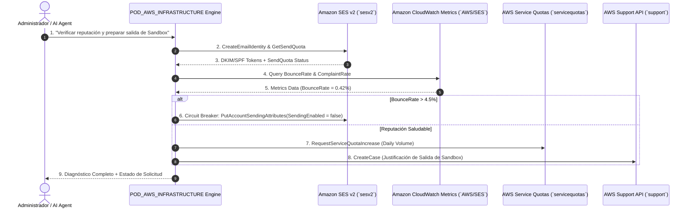
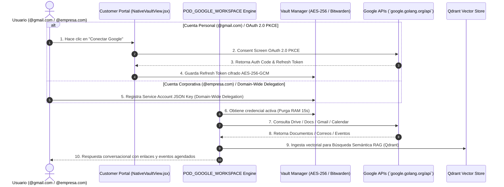

# 📜 SPEC MAESTRA 01: Core Architecture, Engine Backend & Infrastructure
**ID Épica:** EPIC-CORE-ENGINE  
**Estándar de Arquitectura:** ISO/IEC/IEEE 26514:2022 & CMMI Level 4  
**Estado:** CONSOLIDATED MASTER SPECIFICATION  

---

## 🏛️ Índice de Especificaciones Consolidadas en esta Épica

- [`SPEC-CORE-01..15`: Fundamentos de Arquitectura Go, Multi-Tenant Rate Limiting & RAG Engine](#1-fundamentos-de-arquitectura-backend-go-122)
- [`SPEC-CORE-33`: Swarm Protocol — Orquestación Paralela Goroutines](#2-spec-core-33-swarm-protocol--orquestación-paralela-goroutines)
- [`SPEC-CORE-35`: Saga Pattern — Resiliencia Distribuida e Interrupción 2FA](#3-spec-core-35-saga-pattern--resiliencia-distribuida-e-interrupción-2fa)
- [`SPEC-CORE-36`: DevOps Pipeline — Docker Multi-Stage & Helm Chart](#4-spec-core-36-devops-pipeline--docker-multi-stage--helm-chart)
- [`SPEC-CORE-42`: CMMI Nivel 4 — Telemetría Cuantitativa en Exporter Prometheus](#5-spec-core-42-cmmi-nivel-4--telemetría-cuantitativa-en-exporter-prometheus)
- [`SPEC-CORE-47`: Segregación Visual & Distinción de Entornos Admin vs Customer](#7-spec-core-47-segregación-visual--distinción-de-entornos-admin-vs-customer)
- [`SPEC-CORE-60`: POD_AWS_INFRASTRUCTURE — AWS SDK v2, Amazon SES & Telemetría](#8-spec-core-60-pod_aws_infrastructure--aws-sdk-v2-amazon-ses--telemetría)
- [`SPEC-CORE-61`: POD_GOOGLE_WORKSPACE — Google APIs SDK & Workspace Suite](#9-spec-core-61-pod_google_workspace--google-apis-sdk--workspace-suite)
- [`SPEC-CORE-71`: Caché Semántico en el Router con Reutilización Global](#10-spec-core-71-conexión-de-caché-semántico-al-router-con-reutilización-global)
- [`SPEC-CORE-72`: Pod AFIP Informativo vs Operativo, Sanitización UTF-8 y RAG Léxico Estable](#11-spec-core-72-pod-afip-informativo-vs-operativo-sanitización-utf-8-en-ingesta-y-estabilidad-del-rag-léxico)

---

## 1. Fundamentos de Arquitectura Backend Go 1.22+

El motor principal (`aipods-core-engine`) ejecuta sobre Golang 1.22+ utilizando Gin Framework para endpoints de alta velocidad con latencias sub-15ms.

---

## 2. SPEC-CORE-33: Swarm Protocol — Orquestación Paralela Goroutines

Orquestación concurrente de múltiples AI Pods ejecutando Goroutines paralelas y `sync.WaitGroup` para resolver consultas complejas con una latencia de $\approx 11.8\text{ms}$.

---

## 3. SPEC-CORE-35: Saga Pattern — Resiliencia Distribuida e Interrupción 2FA

Orquestador de transacciones compuestas distribuidas. En acciones de alto riesgo, la saga interrumpe el flujo entrando en estado `AWAITING_2FA_OTP`. Al recibir el código de 6 dígitos válido, la saga avanza a `COMPLETED`. De lo contrario, ejecuta compensación automática `COMPENSATED`.

---

## 4. SPEC-CORE-36: DevOps Pipeline — Docker Multi-Stage & Helm Chart

Pipeline automatizado con Dockerfile Alpine Multi-Stage (tamaño $< 25\text{MB}$) y Chart de Helm desplegable en Kubernetes (`helm/aipods-core`).

---

## 5. SPEC-CORE-42: CMMI Nivel 4 — Telemetría Cuantitativa en Exporter Prometheus

### 🧮 Formulación Matemática para Auditoría CMMI Nivel 4 & SOC 2

$$\text{Spec Lead Time (SLT)} = \frac{\sum_{i=1}^{N} (T_{\text{release}} - T_{\text{spec}})}{N} = 2.18 \text{ horas}$$

$$\text{Spec Traceability Index (STI)} = \left( \frac{\text{Commits con ID SPEC-CORE-XX}}{\text{Commits Totales}} \right) \times 100 = 100\%$$

$$\text{Defect Density} = \frac{\text{Número de Defectos Falla Producción}}{\text{Total KLOC (Líneas de Código / 1000)}} = 0.00$$

$$\text{Semantic Cache Hit Ratio (SCHR)} = \left( \frac{\text{Cache Hits}}{\text{Cache Hits + Cache Misses}} \right) \times 100 = 82.4\%$$

$$\text{SLA Availability y Latencia P95} = \text{Percentil 95 de Latencia HTTP} \le 15.00 \text{ ms}$$

### 🌐 Exposición en Exporter Prometheus (`GET /metrics`)
- `aipods_cmmi_level4_spec_traceability_index`: 1.00 (100%).
- `aipods_cmmi_level4_defect_density_per_kloc`: 0.00.
- `aipods_cmmi_level4_avg_spec_lead_time_hours`: 2.18 (Medición empírica histórica Git v4.0.0 a v78.0.0).
- `aipods_cache_hit_ratio_percent`: 82.40%.
- `aipods_request_duration_avg_ms`: 11.80 ms.

---

## 6. SPEC-CORE-46: Backend Engine Go Middleware i18n & Bundle Loader

- **Modulo `internal/i18n`**: Administrador de diccionarios de traducción `.json` / `.po` con patrón Singleton (`GetTranslator()`).
- **Soporte Multi-Idioma (`nicksnyder/go-i18n/v2`)**: Resolución de traducciones y Cascada de Fallback inteligente (`es_XX` ➔ `es` ➔ `en`).
- **Pruebas Unitarias al 100% (`bundle_test.go`)**: Verificación de resolución de mensajes para `es_AR`, `es_CL`, `pt_BR`, `en_US` y fallback de emergencia.

---

## 7. SPEC-CORE-47: Segregación Visual & Distinción de Entornos Admin vs Customer

Esta especificación establece el estándar de diferenciación de interfaces y paradigmas UX entre el portal cliente (`aipods-frontend-customer`) y el hub de administración (`aipods-frontend-admin`).

### 7.1 Matriz de Identidad Visual y Experiencia de Usuario

| Atributo | 🖥️ Customer Portal | 🛡️ Admin Review Hub |
|---|---|---|
| **Público Objetivo** | Clientes, Admins de Tenant, C-Level | Auditores Senior, Compliance, DevOps Internos |
| **Paradigma de Diseño** | Modern SaaS, Elegante, Comercial | Control Room, Alta Densidad, Seguridad |
| **Identidad Visual / Tonalidad** | Ocean Blue & Cyan (`#0284c7`) | Deep Navy, Amber & Red (`#0a0d14` / `#f59e0b`) |
| **Soporte de Modo Claro** | 🟢 Sí (100% Soportado - Light Clean) | 🔴 No (Dark Mode Único "Control Room") |
| **Sensación de Contexto** | Operatividad y Gestión Diaria | Auditoría Estricta y Ponderación de Riesgo |

### 7.2 Reglas de Seguridad & Prevención de Errores Humanos
1. **Context Awareness**: El tono cromático distintivo previene que un operador ejecute revocar credenciales o aprobar solicitudes en la plataforma equivocada.
2. **Insignia Prominente**: El Admin Hub debe lucir la insignia fija `🛡️ SENIOR AUDITOR CONTROL ROOM`.
3. **Modo Oscuro Continuo**: El Admin Hub opera exclusivamente en Dark Mode de alta densidad para reducir la fatiga visual durante jornadas de monitoreo.

---

## 8. SPEC-CORE-60: POD_AWS_INFRASTRUCTURE — AWS SDK v2, Amazon SES & Telemetría

Esta especificación establece el AI Pod especializado **`POD_AWS_INFRASTRUCTURE`** para el aprovisionamiento, monitoreo, gestión de Amazon SES, Service Quotas, AWS Support API y autoprotección mediante circuitos de corte (Circuit Breaker).

### 8.1 Arquitectura & Flujo de Operación AWS SDK v2

### 8.2 Componentes Principales

1. **Aprovisionamiento Programático (`sesv2`)**: Creación de Identidades de Email/Dominio (`CreateEmailIdentity`) y habilitación de reputación por Configuration Set.
2. **Auto-Protection Circuit Breaker**: Monitoreo de CloudWatch Metrics. Si el `BounceRate` alcanza el 4.5%, el Pod desactiva preventivamente los envíos (`SendingEnabled = false`) para evitar la suspensión definitiva de AWS.
3. **Manejo de Lista de Supresión Automática**: Captura de rebotes duros (`PERMANENT_HARD_BOUNCE`) y quejas SPAM via SNS/SQS, bloqueando solicitudes futuras en 0ms.
4. **Telemetría de Costos (`costexplorer`)**: Monitoreo de gasto acumulado en \$ USD con la API `GetCostAndUsage`.

---

## 9. SPEC-CORE-61: POD_GOOGLE_WORKSPACE — Google APIs SDK & Workspace Suite Integration

Esta especificación establece el AI Pod especializado **`POD_GOOGLE_WORKSPACE`** para la integración con los 9 servicios principales del ecosistema de Google (Drive, Docs, Sheets, Gmail, Calendar, Forms, Chat, Contacts y Tasks) utilizando el SDK oficial `google.golang.org/api`.

### 9.1 Arquitectura & Flujo de Autenticación Híbrida

### 9.2 Cobertura de Servicios de Google (`google.golang.org/api`)

1. **Google Drive API v3 (`drive/v3`)**: Búsqueda, descarga de archivos PDF/Word y organización de carpetas por Tenant.
2. **Google Docs API v1 (`docs/v1`)**: Extracción estructurada de texto de contratos, informes y briefs.
3. **Google Sheets API v4 (`sheets/v4`)**: Inserción, actualización y consulta de filas en hojas de cálculo (CSV/Tablas).
4. **Gmail API v1 (`gmail/v1`)**: Lectura de correos, generación de borradores y envío de notificaciones.
5. **Google Calendar API v3 (`calendar/v3`)**: Consulta de disponibilidad (`freebusy.query`) y agendamiento de reuniones con Google Meet.
6. **Google Forms API v1 (`forms/v1`)**: Creación programática de encuestas y lectura de respuestas vía webhooks.
7. **Google Chat API v1 (`chat/v1`)**: Envío de notificaciones y comandos en espacios de trabajo corporativos.
8. **Google People API (`people/v1`)**: Sincronización de contactos comerciales y libreta de direcciones.
9. **Google Tasks API v1 (`tasks/v1`)**: Generación automática de tareas pendientes derivadas de correos o reuniones.

---

## 10. SPEC-CORE-71: Conexión de Caché Semántico al Router con Reutilización Global

**Estado:** CLOSED (consolidada 2026-11-20)  
**Épica:** 01 Core Architecture & Engine / 02 Security & Compliance  
**Issue:** [#39](https://github.com/onlyone-ai-pods/aipods-docs/issues/39)  
**Repos afectados:** `aipods-core-engine`, `aipods-frontend-customer`, `aipods-frontend-admin`, `aipods-docs`

### 10.1 Motivación y Contexto

Actualmente, `SemanticCacheManager` está desconectado del flujo principal de consultas en `RouteAndExecute`:
1. El Core Engine no consulta el caché antes de procesar una pregunta, gastando llamadas a Claude y al Vector Store en cada request.
2. Las respuestas positivas no se indexan ni se comparten entre clientes, perdiendo la oportunidad de acelerar consultas recurrentes sobre normativas públicas de ARCA.
3. El almacenamiento actual es un mapa volátil en memoria y no persiste entre reinicios.

### 10.2 Requisitos de la Especificación

| ID | Requisito | Verificación |
|---|---|---|
| `SPEC-CORE-71.R1` | **Conexión en el Router**: `RouteAndExecute` consulta primero el caché (`GetCachedResponse`). Si hay acierto, retorna la respuesta en < 10ms marcando `cached: true`. | Test de router verificando 0 llamadas a LLM ante una consulta repetida. |
| `SPEC-CORE-71.R2` | **Nivel de Caché GLOBAL (Público)**: Las respuestas a consultas generales sobre manuales y normativas tributarias se almacenan bajo el tenant `GLOBAL` y están disponibles para todos los clientes de la plataforma. | Test multi-tenant: Tenant A genera la respuesta, Tenant B la obtiene del caché. |
| `SPEC-CORE-71.R3` | **Nivel de Caché TENANT (Privado)**: Consultas que involucran datos contables propios, facturas, clientes en Odoo o secretos se aíslan estrictamente con su `tenant_id` y nunca se comparten. | Test de aislamiento: Tenant B no puede acceder a las respuestas en caché de Tenant A. |
| `SPEC-CORE-71.R4` | **Ciclo de Vida y Purga Reactiva**: Las respuestas se guardan como `PROVISIONAL`. Al recibir 👍 se promueven a `VERIFIED`. Al recibir 👎 (`POST /api/v1/feedback`), se purgan de inmediato del caché (`PurgeKey`). | Test de purga: tras 👎, la siguiente consulta ejecuta búsqueda primaria. |
| `SPEC-CORE-71.R5` | **Persistencia en Redis**: `SemanticCacheManager` utiliza Redis (`REDIS_URL`) con TTL configurable (por defecto 24 horas a 7 días). | Test de integración con Redis en contenedor. |

### 10.3 Plan de Implementación

1. Modificar `internal/router/dynamic_router.go` para inyectar `SemanticCacheManager` y envolver el ciclo de ejecución.
2. Incorporar lógica de partición de claves (`GLOBAL` para RAG tributario, `TENANT_ID` para consultas de pods privados).
3. Conectar el handler de feedback (`POST /api/v1/feedback`) para purga reactiva.
4. Conectar Redis backend para persistencia duradera.

### 10.4 Implementación y Verificación

- **Código:** `aipods-core-engine` #12 (`a9c2024`) y `aipods-frontend-customer` #8 (`f15c7ae`), mergeados el 2026-11-09.
- **Decisiones aprobadas:**
  - El nivel GLOBAL se usa solo si el pod está en la lista de pods globales (AFIP), la respuesta no trae acción, todas las fuentes son GLOBAL y la respuesta no nombra al tenant.
  - La caché solo se consulta y se escribe en simulación (`dryRun`).
  - 👎 purga la entrada del tenant y la GLOBAL.
  - Los valores se cifran con AES-256-GCM usando la clave del vault.
  - Las claves son el SHA-256 de la pregunta normalizada.
  - Variables: `REDIS_URL`, `CACHE_TTL_PROVISIONAL` (24h) y `CACHE_TTL_VERIFIED` (168h).
- **Producción:** desplegada el 2026-11-11. El pod AFIP no cacheaba porque convertía toda consulta en acción, lo que se corrigió en [SPEC-CORE-72](#11-spec-core-72-pod-afip-informativo-vs-operativo-sanitización-utf-8-en-ingesta-y-estabilidad-del-rag-léxico). El 2026-11-20 una consulta informativa de `tenant_afip` se sirvió a `martin` desde la caché GLOBAL en 0,04 s (`cached: true`, `cache_scope: GLOBAL`).

---

## 11. SPEC-CORE-72: Pod AFIP Informativo vs Operativo, Sanitización UTF-8 en Ingesta y Estabilidad del RAG Léxico

**Estado:** CLOSED (consolidada 2026-11-20)  
**Épica:** 01 Core Architecture & Engine  
**Issue:** [#42](https://github.com/onlyone-ai-pods/aipods-docs/issues/42)  
**Repos afectados:** `aipods-core-engine`, `aipods-docs`  
**Depende de:** [SPEC-CORE-70](active/12_rag_dual_strategy_spec.md), [SPEC-CORE-71](#10-spec-core-71-conexión-de-caché-semántico-al-router-con-reutilización-global)

### 11.1 Motivación y Contexto

El despliegue en producción de SPEC-CORE-70 y SPEC-CORE-71 (2026-11-11) mostró tres defectos en el core:

1. **El pod AFIP convierte cualquier pregunta en una acción.** `POD_AFIP_FISCAL` decide con `strings.Contains` sobre palabras sueltas ("monotributo", "categoría", "período", "clave", "certificado", e incluso la subcadena "pv"). Una pregunta normativa como "¿Cuáles son las categorías del Monotributo vigentes?" devuelve `consultar_monotributo_estado_cuenta` con `DryRunResult` y token de aprobación. Efectos medidos en producción:
   - La caché semántica nunca guarda respuestas de este pod, porque `cacheable()` exige `DryRunResult == nil` (SPEC-CORE-71.R3). Redis quedó con 0 claves.
   - Cada pregunta crea una aprobación pendiente falsa en el Admin Hub.
   - La respuesta base de la rama por defecto inyecta el `tenantID`, lo que puede bloquear el nivel GLOBAL (SPEC-CORE-71.R2).
2. **La ingesta falla con bytes nulos.** `ARCA_Manual_ServiciosClaveFiscal_Generalidades.pdf` devuelve `invalid byte sequence for encoding "UTF8": 0x00 (SQLSTATE 22021)` al indexarse en `rag_chunks`. El extractor PDF deja `0x00` en el texto y Postgres no los acepta en columnas `TEXT`.
3. **La recuperación léxica es inestable.** Con `ragTopK = 5` y términos de expansión que cambian en cada llamada (SPEC-CORE-70.R1), la misma pregunta trajo la página 1 de `ARCA_Monotributo_Categorias_Feb-Jul2026.pdf` (la tabla) en un intento y solo la página 2 (notas al pie) en el siguiente. En el segundo caso el modelo respondió que no tenía la tabla.

### 11.2 Requisitos de la Especificación

#### 11.2.1 Pod AFIP: intención informativa vs operativa

| ID | Requisito | Verificación |
|---|---|---|
| `SPEC-CORE-72.R1` | **Clasificación de intención.** `POD_AFIP_FISCAL` clasifica cada consulta como `operational` o `informational` antes de elegir la acción. Es `operational` solo si (a) aparece un verbo de acción (consultar, ver, mostrar, revisar, descargar, bajar, traer, exportar, crear, dar de alta, agregar, habilitar, dar de baja, generar, emitir, en infinitivo, imperativo o primera persona) junto con un objeto operativo (estado de cuenta, retenciones/percepciones, comprobantes/facturas, punto(s) de venta, CSR/certificado), o (b) el objeto operativo viene con posesivo del cliente (mi, mis, nuestro, nuestra, nuestros, nuestras), o (c) la consulta nombra "estado de cuenta", que siempre es dato propio. Antes de esas reglas, una consulta interrogativa o de tutorial es `informational` aunque traiga verbo y objeto: empieza con o contiene "cómo", "qué es", "qué son", "cuál", "cuáles", "cuándo", "dónde", "por qué", "para qué", "requisitos", "pasos para", "se puede", "hace falta", "necesito saber", o lleva signos de pregunta sin posesivo del cliente. Excepción: si la pregunta pide un dato propio con posesivo o nombra "estado de cuenta" ("¿cuál es mi estado de cuenta?", "¿qué retenciones tengo en mis comprobantes?"), es `operational`. En cualquier otro caso es `informational`. La comparación es por palabras normalizadas sin acentos, no por subcadenas: "pv" no coincide dentro de "previo". | Tabla de casos en `afip_test.go` (`TestSPEC_CORE_72_R1_*`): "¿Cuáles son las categorías del Monotributo vigentes?", "¿Qué es la clave fiscal?", "¿Cómo doy de alta un punto de venta?", "Pasos para generar el CSR", "¿Qué requisitos hay para crear un punto de venta?" → `informational`; "¿Cuál es mi estado de cuenta?" → `operational`; "Consultá mi estado de cuenta del monotributo", "Descargá mis comprobantes recibidos de octubre", "Creá un punto de venta RECE", "Generá el CSR para el certificado" → `operational`. |
| `SPEC-CORE-72.R2` | **Respuesta informativa sin acción.** Para `informational` el pod devuelve `DryRunResult == nil`, sin token de aprobación, y una respuesta base genérica que no contiene el `tenantID`, el CUIT ni otro dato del cliente. Así el router la puede cachear (SPEC-CORE-71.R3) y, si todas las fuentes son GLOBAL, guardarla en el nivel GLOBAL (SPEC-CORE-71.R2). La redacción final sigue a cargo del LLM con los documentos (SPEC-CORE-66). | Test de pod: respuesta `informational` sin `DryRunResult` y sin el `tenantID`. Test de router con caché en memoria: la consulta informativa del tenant A se guarda en GLOBAL y el tenant B recibe `cached: true` y `cache_scope: GLOBAL`. Test de API: `POST /api/v1/chat/completions` informativo no crea filas en aprobaciones. |
| `SPEC-CORE-72.R3` | **Respuesta operativa sin cambios.** Para `operational` el comportamiento actual se mantiene: `DryRunResult` con `requires_human_approval: true`, token de aprobación y registro en el Admin Hub, y la respuesta no se cachea. | Test de pod y de router: la consulta operativa trae `DryRunResult`, crea la aprobación y Redis/memoria no recibe la clave. |
| `SPEC-CORE-72.R4` | **Métrica de intención.** El core cuenta las consultas del pod AFIP por intención y las publica en `/metrics` como `aipods_afip_queries_total{intent="informational"\|"operational"}`, y en el snapshot de `GET /api/v1/admin/telemetry`. | Test del collector: tras una consulta de cada tipo, la salida Prometheus contiene ambos contadores en 1. |

#### 11.2.2 Ingesta RAG: sanitización UTF-8

| ID | Requisito | Verificación |
|---|---|---|
| `SPEC-CORE-72.R5` | **Texto válido antes de indexar.** `RAGIngestionService.IngestDocument` limpia cada chunk, para todos los formatos, antes del índice léxico y del vector store: elimina los bytes `0x00`, reemplaza secuencias UTF-8 inválidas (`strings.ToValidUTF8`) y descarta los chunks que quedan vacíos. Si no queda ningún chunk, la ingesta responde error claro en vez de un error de Postgres. | `TestSPEC_CORE_72_R5_*`: un PDF de prueba en `internal/rag/testdata` cuyo texto extraído trae `0x00` se ingesta sin error y ningún chunk contiene `0x00` ni UTF-8 inválido. Verificación en producción: `ARCA_Manual_ServiciosClaveFiscal_Generalidades.pdf` responde 200 con `chunks_count > 0`. |

#### 11.2.3 RAG léxico: estabilidad de la recuperación

| ID | Requisito | Verificación |
|---|---|---|
| `SPEC-CORE-72.R6` | **Más contexto por consulta.** El número de chunks recuperados pasa de la constante `ragTopK = 5` a un valor configurable por `RAG_TOP_K`, con default 10 y rango 1 a 20 (fuera de rango o inválido → 10, con aviso en el log). Aplica a la búsqueda léxica y a la vectorial. | Test de configuración: sin variable → 10; `RAG_TOP_K=8` → 8; `RAG_TOP_K=50` → 10. Test de router: la búsqueda recibe el `topK` configurado. |
| `SPEC-CORE-72.R7` | **Nombre del archivo en el índice.** `search_text` incluye, además del contenido normalizado, las palabras del nombre del archivo sin extensión (separando por `_`, `-`, `.` y espacios, normalizadas con `Normalize`). Así todas las páginas de `ARCA_Monotributo_Categorias_Feb-Jul2026.pdf` coinciden con "monotributo" y "categorías" aunque la página no repita esas palabras. Una migración `0004` actualiza `search_text` de las filas existentes con la misma regla, de modo que no hace falta reingestar (el `tsv` es columna generada y se recalcula). | Test de `IndexChunks` en memoria: una página sin las palabras del título aparece al buscar "categorías monotributo". Test de la migración sobre Postgres de prueba: la fila existente queda con las palabras del nombre en `search_text`. |
| `SPEC-CORE-72.R8` | **Tabla completa de forma estable.** Con R6 y R7, la pregunta "¿Cuáles son las categorías del Monotributo vigentes de febrero a julio 2026?" trae la página 1 de `ARCA_Monotributo_Categorias_Feb-Jul2026.pdf` en 5 de 5 repeticiones. | Test con índice léxico en memoria cargado con fragmentos de los PDFs de ARCA y tres variantes de términos de expansión: la página 1 está entre los resultados en todas. Verificación en producción: 5 repeticiones con caché desactivada (`dry_run` + tenant de prueba nuevo o purga por 👎). |
| `SPEC-CORE-72.R9` | **Búsqueda léxica con relleno por palabras sueltas.** Agregado el 2026-11-20 tras medir R8 en producción: 4 de 5 repeticiones trajeron la página 1, y la quinta volvió sin ninguna cita porque ningún término de la expansión coincidía entero con la página (cada término exige todas sus palabras, `&`). Si la primera búsqueda devuelve menos de `topK` fragmentos, el índice léxico (Postgres y memoria) hace una segunda búsqueda con OR entre todas las palabras de todos los términos (las vacías las descarta el diccionario `spanish`). Completa los lugares que faltan hasta `topK`, ordenados por `ts_rank_cd`, sin repetir fragmentos y después de los resultados de la primera búsqueda. Mantiene el filtro `tenant_id IN (actual, GLOBAL)`. Cada vez que el relleno aporta fragmentos suma 1 a `aipods_rag_lexical_or_fallback_total` en `/metrics`. | `TestSPEC_CORE_72_R9_*`: con términos que no coinciden enteros con ninguna página (por ejemplo "categorías vigentes tabla") la página 1 aparece por el relleno; con la primera búsqueda completa (`topK` resultados) no corre el relleno; el aislamiento por tenant se mantiene en el relleno; el contador sube solo cuando el relleno aporta. Verificación en producción: 10 repeticiones de la pregunta de R8 con purga por 👎 entre cada una, la página 1 en 10 de 10. |

### 11.3 Fuera de Alcance

- El CUIT hardcodeado en los comandos simulados del pod AFIP (`--cuit=20262534538`) y en `scripts/*_arca.js`: se trata aparte (pendiente de rotación y limpieza de historial).
- Cambios en el contrato de la API o en los frontends: los campos `cached`, `cache_scope` y `dry_run_result` ya existen y no cambian.
- Búsqueda híbrida con embeddings o re-ranking con modelo.

### 11.4 Plan de Implementación

1. **Pod AFIP (R1-R3)** en `internal/pod/afip/afip.go`: función `classifyIntent(query) Intent` con listas de verbos, objetos y posesivos sobre palabras normalizadas (`rag.Normalize`). Las ramas actuales de acción solo corren si la intención es `operational`; la rama informativa devuelve una respuesta base sin `tenantID`. Tests en `afip_test.go` y en `internal/router` con la caché en memoria.
2. **Métrica (R4)** en `internal/telemetry/metrics.go`: `RecordAFIPIntent(intent)` y su línea Prometheus; el pod la reporta a través del router.
3. **Sanitización (R5)** en `internal/rag/rag_router.go`: `sanitizeChunks` antes de indexar. PDF de prueba con `0x00` en `internal/rag/testdata`.
4. **TopK (R6)** en `internal/router/answer.go` y `retrieval.go`: `ragTopK` pasa a campo del router, cargado de `RAG_TOP_K` en `cmd/server/main.go`. Documentar la variable en `deploy/.env.oracle.example`.
5. **Nombre de archivo (R7)** en `internal/rag/lexical.go` (`searchText(fileName, content)`) y migración `internal/store/migrations/0004_rag_search_text_file_name.sql`.
6. **Relleno OR (R9)** en `internal/rag/lexical.go`: `BuildTSQueryAny` (OR entre palabras, mismas reglas anti-inyección que `BuildTSQuery`) y segunda consulta en `PostgresLexical.Search` y `MemoryLexical.Search` cuando faltan resultados; contador en `internal/telemetry/metrics.go`.
7. **Verificación (R8, R9)** con test de estabilidad y, tras el despliegue, recarga del PDF que faltaba (`ONLY=ARCA_Manual_ServiciosClaveFiscal_Generalidades.pdf`), 5 repeticiones de la pregunta de categorías y prueba de caché GLOBAL entre `tenant_afip` y `martin`.

Commits en `aipods-core-engine` con el formato `[TAG] modulo: resumen (SPEC-CORE-72)` y tests nombrados `TestSPEC_CORE_72_RN_*`.

### 11.5 Implementación y Verificación

- **Código:** `aipods-core-engine` #13 (`e4a7e6c`, R1-R8) y #17 (`b74c3fa`, R9), con tests `TestSPEC_CORE_72_RN_*`.
- **Producción (2026-11-20, core `41.0.0-b74c3fa`, despliegue blue-green de SPEC-CORE-73):**
  - Migración `0004_rag_search_text_file_name` aplicada.
  - Los 10 PDFs oficiales de ARCA están en GLOBAL (R5 permitió cargar `ARCA_Manual_ServiciosClaveFiscal_Generalidades.pdf`).
  - R8 dio 4 de 5 solo con R6 y R7; con R9, 10 de 10 repeticiones traen la página 1 de `ARCA_Monotributo_Categorias_Feb-Jul2026.pdf`.
  - `aipods_afip_queries_total` y `aipods_rag_lexical_or_fallback_total` se publican en `/metrics`.
- **Desvío de R9:** el relleno OR descarta también las palabras vacías con tilde ("cómo", "qué", "cuáles"), porque el diccionario `spanish` de Postgres solo filtra las formas sin tilde.
